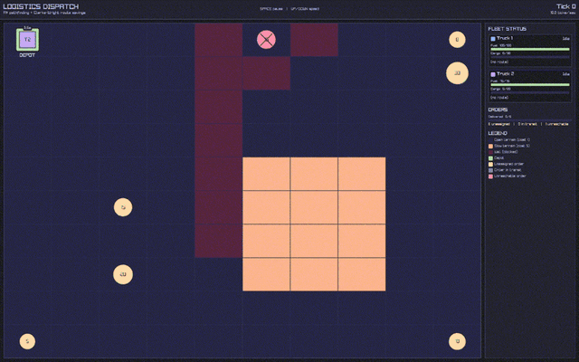

# Vehicle Routing Problem

I am filled with indescribable feelings of pure happiness by your very presence, and thus I am more than honored to humbly present to you my very own take on the famously known
[Vehicle Routing Problem (VRP)](https://en.wikipedia.org/wiki/Vehicle_routing_problem), spiced up with the following additions:
- **Capacitated Vehicle Routing Problem (CVRP):** Vehicles have strict cargo capacity limits. 
- **Multiple Trips (VRPMT):** Vehicles return to the depot, refuel, and take on subsequent delivery waves until all orders are complete. 
- **Terrain-Aware Costs:** Travel costs reflect actual navigable terrain rather than simplified Euclidean (straight-line) distances. 
- **Tick-Based Simulation:** Dynamic execution driven by discrete ticks and per-truck state machines, which is then rendered by Raylib-cs.

For those who are not familiar with the [Vehicle Routing Problem (VRP)](https://en.wikipedia.org/wiki/Vehicle_routing_problem), it is said to be: "What is the optimal set of routes for a fleet of vehicles to traverse in order to deliver to a given set of customers?"



## Overview

### How does it work (In simple terms)

The entire project is made in C# and functions as follows:
1. **Setup:** Initializes the grid map, delivery orders (coordinates and cargo weight), and truck fleet specifications (storage limit, fuel capacity, recharge rate).
2. **[Pathfinding (A*)](https://en.wikipedia.org/wiki/A*_search_algorithm):** Calculates true shortest paths across the terrain grid. Instead of assuming straight lines, it routes around obstacles (cost 99) and accounts for difficult terrain (cost 5), caching the results into a pairwise distance matrix.
3. **[Route Planning (Clarke & Wright Savings)](https://en.wikipedia.org/wiki/Clarke_and_Wright_savings_algorithm):**
   * Calculates fuel savings for serving two orders on a shared route versus two separate round trips to the depot ($S_{ij} = d_{i0} + d_{0j} - d_{ij}$).
   * Iterates through order pairs sorted by highest savings, merging routes while validating that neither vehicle cargo capacity nor maximum fuel range is breached.
   * Assigns any leftover unmerged orders to available vehicles with spare capacity.
4. **Tick-Based Simulation:** A discrete-time loop updates each truck through a state machine (`Idle`, `Loading`, `Driving`, `Refueling`). Trucks physically traverse their A* path tile-by-tile, consume fuel based on terrain cost, spend ticks unloading at delivery points, and return to the depot to replenish fuel.
5. **GUI:** A visualizer layer for the simulation using the [Raylib-cs](https://github.com/ChrisDill/Raylib-cs) library.

<details>
<summary><b>Running and Editing Explanation</b> (Click to expand)</summary>

## How to Run It

In order to breathe life into this wonderful creation, the following steps must be executed in the exact order:

### Primo
Clone the repository onto your machine of choice:

```bash
git clone https://github.com/your-username/your-repo-name.git
cd your-repo-name
```

### Secundo

The engine requires the **.NET 8.0 SDK** (or newer). Raylib-cs bundles its own native binaries for desktop platforms, but on Linux some windowing dependencies are required.

#### Linux (Fedora)

```bash
# Install .NET SDK if not already present
sudo dnf install dotnet-sdk-8.0

# Install Raylib graphic/windowing dependencies (X11 / OpenGL)
sudo dnf install libX11-devel libXcursor-devel libXrandr-devel libXinerama-devel libXi-devel mesa-libGL-devel
```

#### Linux (Ubuntu / Debian)

```bash
sudo apt update
sudo apt install -y dotnet-sdk-8.0 libgl1-mesa-dev libxi-dev libxcursor-dev libxrandr-dev libxinerama-dev
```

#### macOS

```bash
# Using Homebrew
brew install --cask dotnet-sdk
```

#### Windows

Download and install the **[.NET SDK Installer](https://dotnet.microsoft.com/download)** directly from Microsoft.

#### Restore NuGet Packages

Once inside the project directory, restore the required dependencies (including Raylib-cs):

```bash
dotnet restore
```

### Tertio
It is almost ready! Only one last step remains.

```bash
dotnet run
```

_(This automatically compiles the binaries and launches the Raylib visualizer window.)_

## How to control it

Once the simulation is set in motion, you can interact with the visualizer using the following keys:

| Key | Action |
| :--- | :--- |
| **Space** | Pause / Resume simulation |
| **Up Arrow** | Increase tick rate (run faster) |
| **Down Arrow** | Decrease tick rate (run slower) |

## Wanna change the behavior?

You can tweak the map grid, orders, and vehicle stats directly inside `Program.cs`:
- **Map Layout (`testingGrid`):** Change terrain costs (`1` for clear ground, `2-99` for rough terrain, `99` for impassable walls).
- **Orders (`Orders.Add`):** Set custom $(X, Y)$ coordinates and delivery cargo weights.
- **Fleet (`Trucks.Add`):** Adjust storage capacity, maximum fuel, and recharge speed per truck.

</details>

## Built With

- **C# / .NET** (Core simulation and algorithmic backend) 
- **[Raylib-cs](https://github.com/ChrisDill/Raylib-cs)** (2D grid rendering and visualizer)

## My thoughts


## Acknowledgements

All core algorithms (A* pathfinding, distance caching, Clarke-Wright heuristics, and the truck state machine) in `Program.cs` and `AstarPathfinding.cs` were implemented by hand. The GUI layer (`SimulationVisualizer.cs`) was generated by AI.
